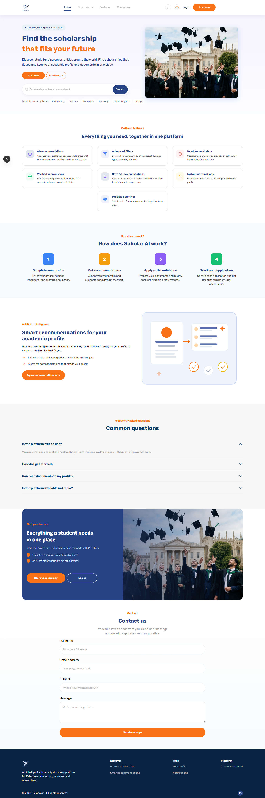

# PS Scholar · Frontend

A bilingual (Arabic/English) scholarship discovery platform for Palestinian students, graduates and researchers. Students build an academic profile, search and filter scholarships, save the ones they like and track their applications. Admins review and publish scholarship listings.

**Live:** [scholar-ai-neon.vercel.app](https://scholar-ai-neon.vercel.app)

<p align="center">
  
</p>

## Features

**Students**
- Sign up and log in with email/password or Google, with email verification and password recovery
- Academic profile with personal information and document uploads
- Scholarship discovery: search, filters (country, level, funding), sorting, pagination, grid and list views
- Saved scholarships with optimistic updates and rollback on failure
- Scholarship details page and application tracking *(behind feature flags until backend sign-off)*

**Admins**
- Dashboard with platform stats and pending reviews
- Review workflow to approve or reject scraped scholarships
- Manual scholarship entry form

**Everywhere**
- Full Arabic (RTL) and English (LTR) support, with Latin digits pinned in both locales
- Responsive layouts for desktop and mobile

## Tech stack

| Area | Tools |
| --- | --- |
| Framework | Next.js 16 (App Router), React 19, TypeScript (strict) |
| Styling | Tailwind CSS v4 |
| Data | TanStack Query v5 (server state), Zustand (client state) |
| Forms | React Hook Form + Zod |
| i18n | next-intl (ar / en) |
| Quality | ESLint, Prettier, Husky + lint-staged, commitlint (Conventional Commits) |
| Tests | Node's built-in test runner (`node --test`), 26 test files |
| Deploy | Vercel |

## Architecture notes

- **Feature-based structure:** each feature lives in `src/features/<feature>` with its own `api`, `components`, `hooks`, `schemas` and `lib` folders.
- **First-party auth cookies:** the browser only calls `/backend/*` on the same origin; a server-side proxy forwards requests to the API, so the auth cookie stays HttpOnly and first-party.
- **Server-only feature flags:** unfinished features are gated on the server and return `notFound()` when disabled, so they never reach the client.
- **Localized routes:** every page sits under `src/app/[locale]`, and all user-facing text lives in `src/messages/ar.json` and `src/messages/en.json`.

```
src/
├── app/[locale]/      # routes: student, admin, auth pages
├── features/          # auth, profile, student/*, admin/*, landing
├── components/        # shared layout and UI components
├── i18n/ · messages/  # locale config and translations
└── lib/               # API client, feature flags, utilities
```

## Getting started

```bash
pnpm install
cp .env.example .env.local   # then fill in the values
pnpm dev                     # http://localhost:3000
```

| Script | What it does |
| --- | --- |
| `pnpm dev` | Start the dev server |
| `pnpm build` | Production build |
| `pnpm lint` | Run ESLint |
| `pnpm format:check` | Check formatting with Prettier |
| `node --test tests/*.test.mjs` | Run the test suite |

## Related repositories

This frontend is part of the [scholarAI-org](https://github.com/scholarAI-org) project, built during TAQAT's CodeMap 2026 program:
[backend](https://github.com/scholarAI-org/scholarAI-backend) · [recommendation engine](https://github.com/scholarAI-org/scholarAI-engine) · [scraper](https://github.com/scholarAI-org/scholarAI-scrapper)

## Author

Frontend built by **Ahmed Zenaty** · [GitHub](https://github.com/ZenatyAh) · [LinkedIn](https://www.linkedin.com/in/ahmed-zenaty/)
